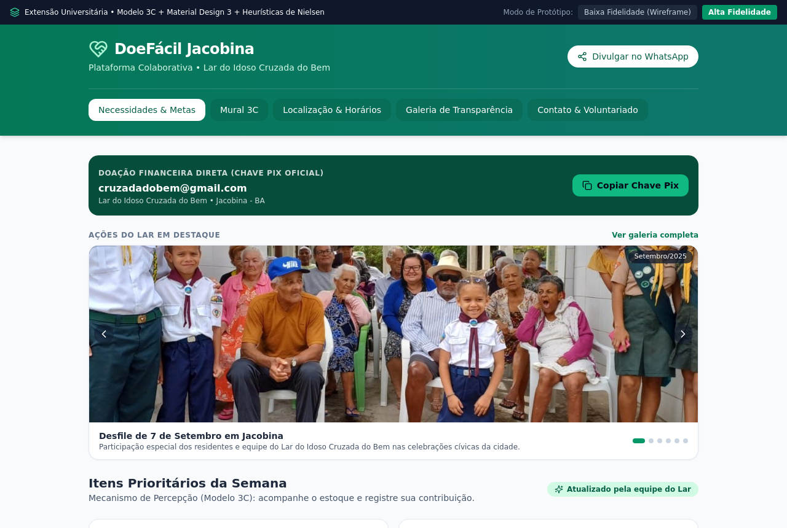

# DoeFácil Jacobina 🤝

**Plataforma colaborativa de doações e pontos de coleta** — projeto de extensão universitária (ODS 1) em apoio ao **Lar do Idoso Cruzada do Bem**, em Jacobina - BA.



---

## Acesso ao projeto

- **Site em produção:** https://doefacil-jacobina.vercel.app/
- **Blog institucional do Lar:** https://sites.google.com/view/lar-do-idosocruzada-do-bem/blog
- **Instituição apoiada:** Lar do Idoso Cruzada do Bem — Rua da Fraternidade, 254 (Félix Tomaz), Jacobina - BA, CEP 44700-000 • (74) 3621-4215
- **Horários de doação:** seg a sex, 14h–16h • sáb e dom, 11h–12h e 14h–16h

---

## Funcionalidades

| Aba | O que faz |
| --- | --- |
| **Necessidades & Metas** | Itens urgentes com barra de progresso, selo de urgência e registro de doação (+1). Banner Pix oficial com botão de cópia. Slideshow automático das ações do Lar. |
| **Mural 3C** | Comunicação colaborativa: mensagens da coordenação e da comunidade em tempo real. |
| **Localização & Horários** | Endereço, horários, rota no Google Maps e redes sociais do Lar. |
| **Galeria de Transparência** | 6 registros fotográficos reais das atividades, hospedados localmente (não dependem de terceiros). |
| **Contato & Voluntariado** | Formulário que entrega a mensagem no **WhatsApp oficial do Lar**, com alternativa por e-mail e consentimento LGPD. |

**Extras pensados para validação e divulgação:**

- Alternador **Baixa Fidelidade (Wireframe) ↔ Alta Fidelidade (M3)** para testar a interface com a comunidade — heuristicas de Nielsen (controle do usuário + consistência)
- **Compartilhamento no WhatsApp** com prévia enxuta (meta tags `og:image`/`og:title`)
- *Mobile-first*, responsivo e leve (site estático, sem backend)

---

## Fundamentação acadêmica

O projeto foi guiado por três pilares:

1. **Modelo 3C de Colaboração (Fuks et al.)** — Comunicação (mural + compartilhamento), Coordenação (pontos de coleta e horários), Cooperação (registro de doações) e Mecanismo de Percepção (*awareness*: barras de progresso, selos de urgência, feed ao vivo).
2. **Material Design 3** — hierarquia visual, superfícies tonais com contraste e navegação mobile-first.
3. **10 Heurísticas de Nielsen** — visibilidade de status, controle/liberdade do usuário (desfazer, alternador de fidelidade) e consistência.

---

## Stack

- **Frontend:** React 18 + Vite 6
- **Estilização:** Tailwind CSS 3
- **Ícones:** Lucide React
- **Deploy contínuo:** Vercel (publicação automática a cada `push` em `main`)

---

## Como executar localmente

Pré-requisitos: [Node.js](https://nodejs.org/) 18+ e `npm`.

```bash
git clone https://github.com/Ralfsantosdev/doefacil-jacobina.git
cd doefacil-jacobina
npm install
npm run dev
```

Acesse `http://localhost:5173`.

```bash
npm run build   # gera a versão de produção em dist/
npm run preview # serve o build localmente
```

---

## Estrutura do projeto

```text
doefacil-jacobina/
├── index.html              # entrada HTML + meta tags de compartilhamento
├── public/
│   └── galeria/            # fotos reais da galeria e do slideshow
├── src/
│   ├── App.jsx             # aplicação inteira (abas, dados, formulários)
│   ├── index.css           # diretivas do Tailwind
│   └── main.jsx            # renderização raiz do React
├── docs/                   # screenshots usados neste README
├── tailwind.config.js
└── vite.config.js
```

### Editando o conteúdo

Todo o conteúdo editável está em **`src/App.jsx`**:

- **Itens das metas** → array `itens` (nome, arrecadado, meta, unidade, urgência)
- **Mural** → array `mensagens`
- **Fotos da galeria e do slideshow** → array `galeriaFotos` (arquivos em `public/galeria/`)
- **Chave Pix, telefone, e-mail e horários** → constantes/banner da aba de campanha e contato (`WHATS_LAR`, `EMAIL_LAR`)

---

## Limitações conhecidas e próximos passos

Honestidade sobre o estado atual (importante para decidir a evolução do projeto):

- **Sem banco de dados:** as barras de progresso e as mensagens do mural vivem apenas na memória do navegador — recarregar zera os valores. São **ilustrativas**, não um controle de estoque real.
- **Próximo passo natural:** persistir metas/mural em um backend (ex.: Supabase) e publicar um **painel administrativo** para a equipe do Lar atualizar conteúdo sem tocar em código.
- Melhorias de segurança já endereçadas: sem segredos no repositório, `.gitignore` adequado, consentimento LGPD no formulário e envio de dados apenas pelos canais oficiais (WhatsApp/e-mail do Lar).

---

## Licença

[MIT](LICENSE) — projeto acadêmico e sem fins lucrativos, feito para ser adaptado e replicado em outras instituições beneficentes.
